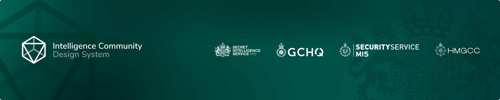

MI6 in open source follows a [Code of Conduct](https://github.com/mi6/ic-design-system/blob/main/CODE_OF_CONDUCT.md) and [Security Policy](https://github.com/mi6/ic-design-system/blob/main/SECURITY.md). Read the Design System's [Privacy Policy](https://design.sis.gov.uk/icds/privacy-policy).
